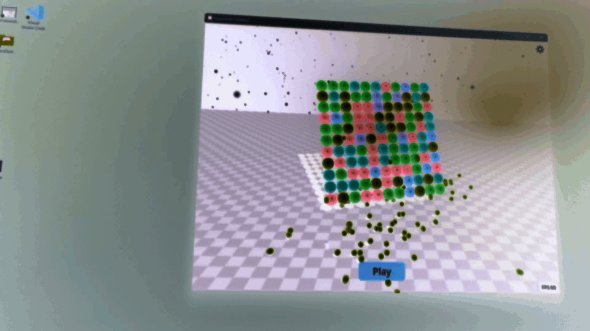
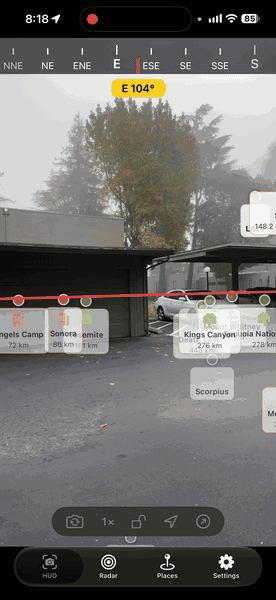
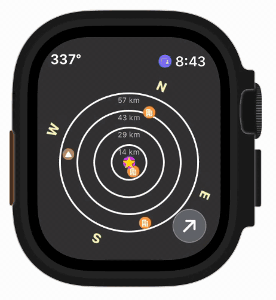
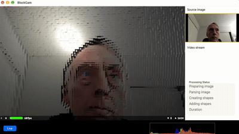

# Portfolio

**Stuart Rankin** · Updated November 2026

## Summary

A collection of the code I've written from 2018 to the present. Most of it targets macOS and iOS and is written in Swift, with UIKit, AppKit, and SwiftUI for the interfaces.

| Project | Platforms | Stack |
|---|---|---|
| [FilterView](https://github.com/sjrankin/FilterView) | macOS, iOS | Swift |
| [BoardTestG](https://github.com/sjrankin/BoardTestG) | macOS, iOS, Windows, Android | Godot |
| [HUDViewWatch](https://github.com/sjrankin/HUDViewWatch) | iOS, watchOS | Swift |
| [ColorManager](https://github.com/sjrankin/ColorManager2) | macOS (iOS-capable) | Swift |
| [Flatland](https://github.com/sjrankin/FlatlandView) | macOS (iOS version available) | Swift, SceneKit, AppKit |
| [DeskBlockCam](https://github.com/sjrankin/DeskBlockCam) | macOS | Swift, SceneKit |

## Projects

### FilterView (macOS, iOS)
A macOS app, with some iOS functionality, that runs filters on images. It also has an imaging pipeline for chaining filters into a sequence.

[Link to FilterView repo](https://github.com/sjrankin/FilterView)

\

### BoardTestG (macOS, iOS, Android, Windows)
A Match-3 game built in Godot with a cubic board. It is cross-platform and performs well on all modern devices.

[Link to BoardTestG repo](https://github.com/sjrankin/BoardTestG) 

BoardTestG running in attract mode with a discontinuous 2D board.

\

### HUDViewWatch (iOS, watchOS)
This app on iPhones shows a live view with points of interest overlayed the camera view. The points of interest remain in place relative to the user as the phone is moved around. A watchOS companion app displays the same information (without the live view) on a radar plot.

Animation of HUDViewWatch running on an iPhone.\
\

Animation of HUDViewWatch running on an Apple Watch.\
\

[Link to HUDViewWatch repo](https://github.com/sjrankin/HUDViewWatch)

### ColorManager (macOS)
Stores named colors and displays them as color chips. Built for macOS, but it also runs on iOS.

[Link to ColorManager repo](https://github.com/sjrankin/ColorManager2)

### Flatland (macOS)
A three-dimensional view of the Earth, with some two-dimensional views, that shows earthquakes in real time. The display and UI are mostly SceneKit, with AppKit for some UI elements. It targets macOS, and I also have an iOS version. I used Claude to port it to RealityKit, but RealityKit lacked functionality that SceneKit provides and I ran into issues such as shadows and lighting availability. Given my recent experience with BoardTestG, I am planning on porting Flatland to Godot.

Flatland running on a Mac showing earthquakes current when the video was created.

\

[Link to Flatland repo](https://github.com/sjrankin/FlatlandView)

### DeskBlockCam (macOS)
A macOS app that converts live camera views into three-dimensional images using SceneKit.

DeskBlockCam running with a live view.

[Link to DeskBlockCam repo](https://github.com/sjrankin/DeskBlockCam)

