# Portfolio

**Stuart Rankin** · Updated November 2026

## Summary

A collection of the code I've written from 2018 to the present. Most of it targets macOS and iOS and is written in Swift, with UIKit, AppKit, and SwiftUI for the interfaces.

| Project | Platforms | Stack |
|---|---|---|
| [FilterView](https://github.com/sjrankin/FilterView) | macOS, iOS | Swift |
| [BoardTestG](https://github.com/sjrankin/BoardTestG) | macOS, iOS, Windows, Android | Godot |
| [HUDViewWatch](https://github.com/sjrankin/HUDViewWatch) | iOS, watchOS, macOS | Swift |
| [ColorManager](https://github.com/sjrankin/ColorManager2) | macOS (iOS-capable) | Swift |
| [Flatland](https://github.com/sjrankin/FlatlandView) | macOS (iOS version available) | Swift, SceneKit, AppKit |
| [FlatlandU](https://https://github.com/sjrankin/FlatlandU) | macOS, iOS, Windows, Android | Godot |
| [DeskBlockCam](https://github.com/sjrankin/DeskBlockCam) | macOS | Swift, SceneKit |
| [BumpCamG](https://github.com/sjrankin/BumpCamG) | macOS, iOS, Windows, Android | Godot |
| [DeskImageFinder](https://github.com/sjrankin/DeskImageFinder) | macOS | Swift |
| [SpectrumAnalyzer](https://github.com/sjrankin/SpectrumAnalyzer) | macOS, iOS | Swift |

## Projects

### FilterView (macOS, iOS)
A macOS app, with some iOS functionality, that runs filters on images. It also has an imaging pipeline for chaining filters into a sequence.

[Link to FilterView repo](https://github.com/sjrankin/FilterView)

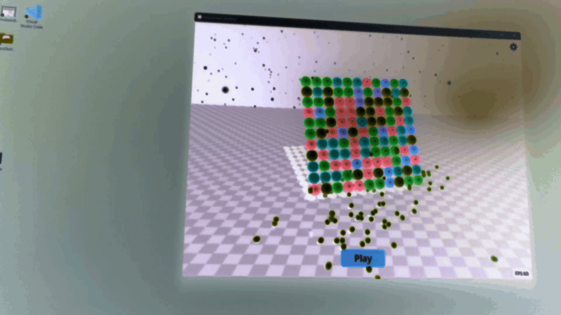

### BoardTestG (macOS, iOS, Android, Windows)
A Match-3 game built in Godot with a cubic board. It is cross-platform and performs well on all modern devices.

[Link to BoardTestG repo](https://github.com/sjrankin/BoardTestG) 

BoardTestG running in attract mode with a discontinuous 2D board.

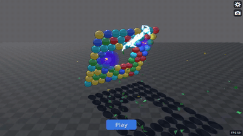

### HUDViewWatch (iOS, watchOS, macOS)
This app on iPhones shows a live view with points of interest overlayed the camera view. The points of interest remain in place relative to the user as the phone is moved around. A watchOS companion app displays the same information (without the live view) on a radar plot. A companion macOS program is part of the project that mirrors the iPhone's orientation and location and points of interest.

Animation of HUDViewWatch running on an iPhone.\
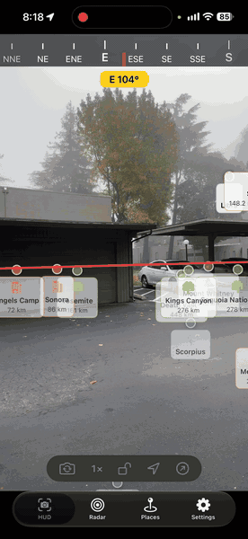

Animation of HUDViewWatch running on an Apple Watch.\
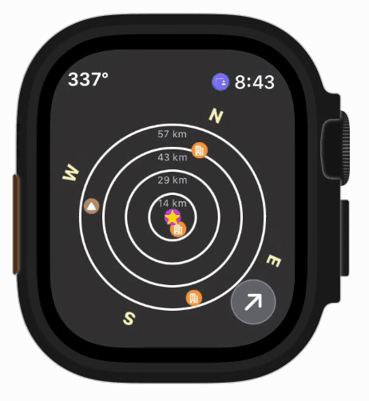

Animation of HUDViewMac running on a Mac Mini with the controller iPHone shown as well.\
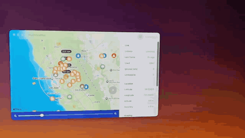

[Link to HUDViewWatch repo](https://github.com/sjrankin/HUDViewWatch)

### ColorManager (macOS)
Stores named colors and displays them as color chips. Originally written in C# and WPF for Windows, ported to macOS. (The app can run on iOS but several features are removed for that platform.)

View of theColor manager showing various colors.\
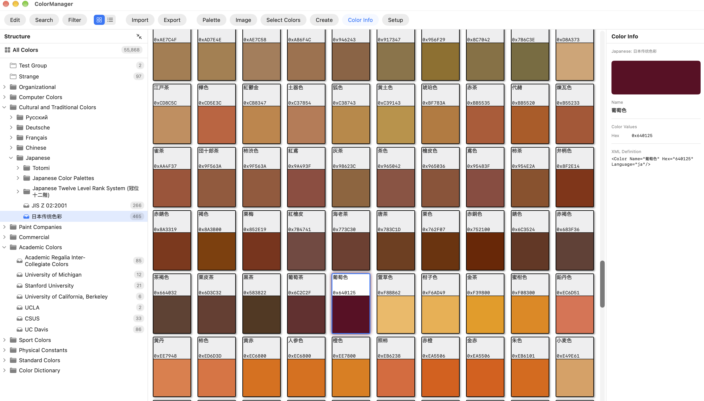

[Link to ColorManager repo](https://github.com/sjrankin/ColorManager2)

### Flatland (macOS)
A three-dimensional view of the Earth, with some two-dimensional views, that shows earthquakes in real time. The display and UI are mostly SceneKit, with AppKit for some UI elements. It targets macOS, and I also have an iOS version. I used Claude to port it to RealityKit, but RealityKit lacked functionality that SceneKit provides and I ran into issues such as shadows and lighting availability. Given my recent experience with BoardTestG, I am planning on porting Flatland to Godot.

Flatland running on a Mac showing earthquakes current when the video was created.

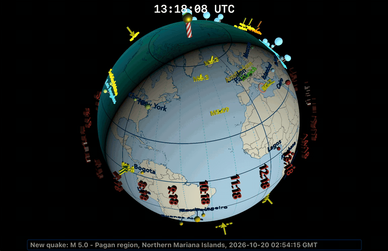

[Link to Flatland repo](https://github.com/sjrankin/FlatlandView)

#### Flatland Universal
This is a port of Flatland (see above) to Godot via Claude. Claude enables straightforward cross-compilation to other platforms, which was one of the goals of Flatland Universal (project name FlatlandU).

Flatland Universal showing the orbiting welcoming text.

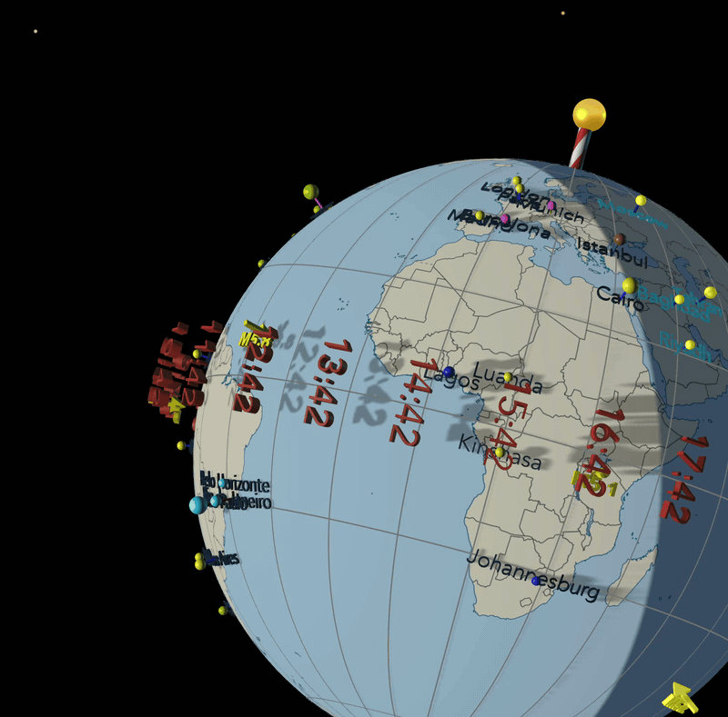

Flatland Universal in an alternate attract mode:

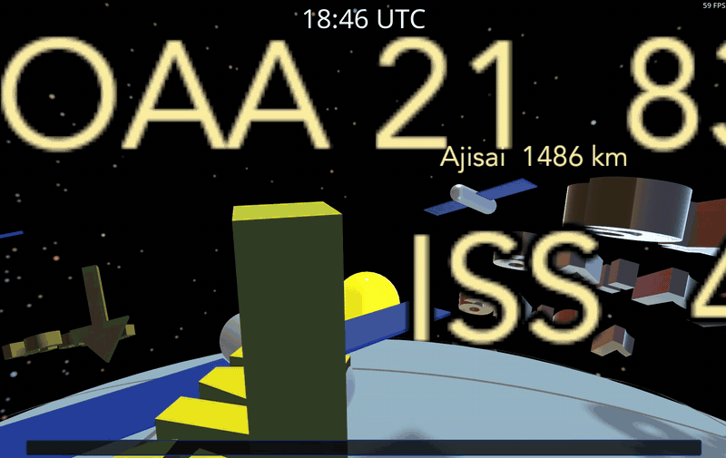

[Link to FlatlandU repo](https://https://github.com/sjrankin/FlatlandU)

### DeskBlockCam (macOS)
A macOS app that converts live camera views into three-dimensional images using SceneKit.

DeskBlockCam running with a live view.

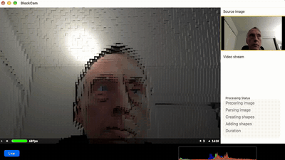

[Link to DeskBlockCam repo](https://github.com/sjrankin/DeskBlockCam)

#### BumpCamG
I ported DeskBlockCam to Godot. The first pass has most of the same features but a different UI. I added a few new features as well.

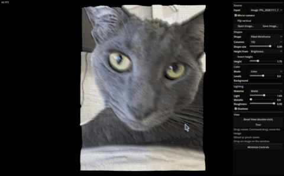

[Link to BumpCamG repo](https://github.com/sjrankin/BumpCamG)

### Desk Image Finder (macOS)
App that runs on Macs that searches for similar images. Answers the question: Do I already have this image somewhere? Arranges images in order of similarity.

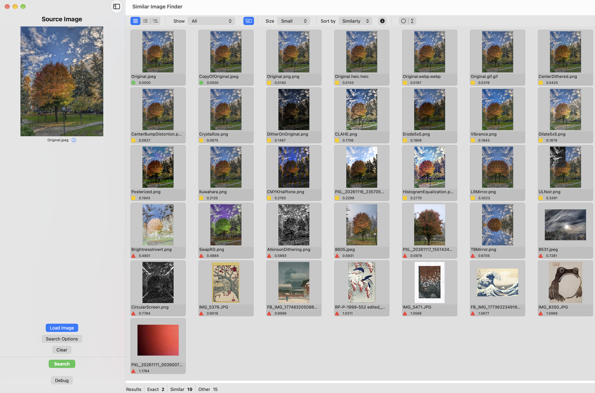

[Link to DeskImageFinder repo](https://github.com/sjrankin/DeskImageFinder)

### SpectrumAnalyzer
A quick app to apply a sound spectrum to a histogram of an app. The results were interesting but not what I was looking for.

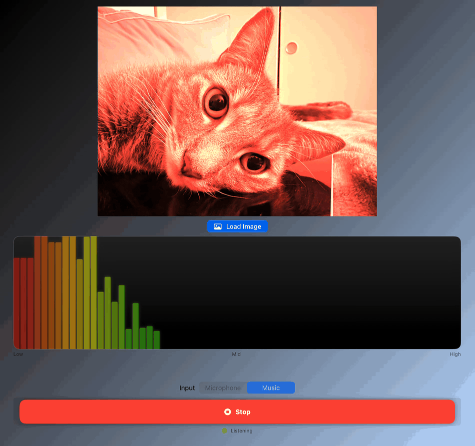

[Link to SpectrumAnalyzer repo](https://github.com/sjrankin/SpectrumAnalyzer)
