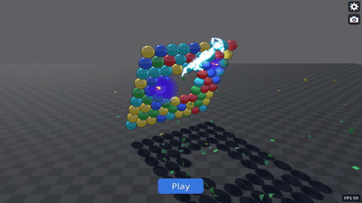
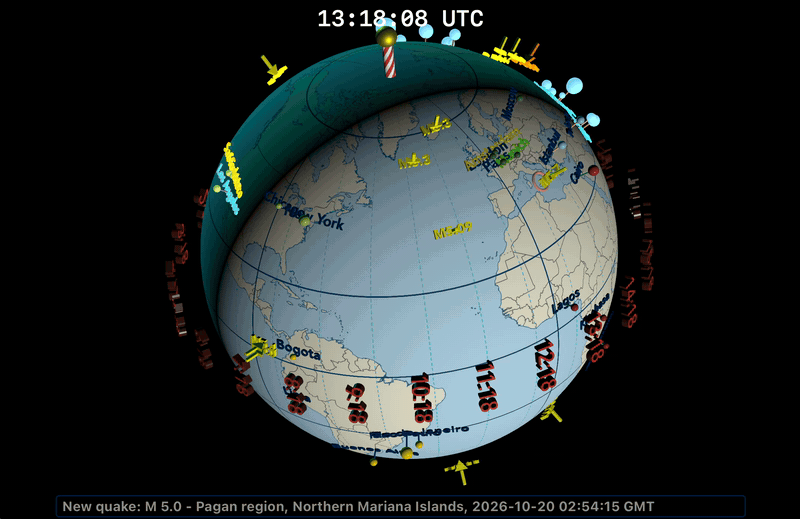

# Portfolio

**Stuart Rankin** · Updated November 2026

## Summary

A collection of the code I've written from 2018 to the present. Most of it targets macOS and iOS and is written in Swift, with UIKit, AppKit, and SwiftUI for the interfaces.

| Project | Platforms | Stack |
|---|---|---|
| [FilterView](https://github.com/sjrankin/FilterView) | macOS, iOS | Swift |
| [BoardTestG](https://github.com/sjrankin/BoardTestG) | macOS, iOS, Windows, Android | Godot |
| [HUDView](https://github.com/sjrankin/HUDView) / [HUDViewUI](https://github.com/sjrankin/HUDViewUI) / [POIView2](https://github.com/sjrankin/POIView2) | iOS, watchOS | Swift |
| [ColorManager](https://github.com/sjrankin/ColorManager_March2026) | macOS (iOS-capable) | Swift |
| [Flatland](https://github.com/sjrankin/FlatlandView) | macOS (iOS version available) | Swift, SceneKit, AppKit |
| [DeskBlockCam](https://github.com/sjrankin/DeskBlockCam) | macOS | Swift, SceneKit |

## Projects

### FilterView (macOS, iOS)
A macOS app, with some iOS functionality, that runs filters on images. It also has an imaging pipeline for chaining filters into a sequence.

### BoardTestG (macOS, iOS, Android, Windows)
A Match-3 game built in Godot with a cubic board. It is cross-platform and performs well on all modern devices.

BoardTestG running in attract mode with a discontinuous 2D board.

\

### HUDView / HUDViewUI / POIView2 (iOS, watchOS)
Three apps with the same core idea: point to points of interest based on the device's orientation.
- **HUDView** and **HUDViewUI** (iOS) overlay points of interest on a live camera view.
- **POIView2** (watchOS) uses a radar-style display to show the direction and distance to each point of interest.

HUDView running with a live view.

\

POIView2 running with a radar display showing relative locations and distances.

\

### ColorManager (macOS)
Stores named colors and displays them as color chips. Built for macOS, but it also runs on iOS.

### Flatland (macOS)
A three-dimensional view of the Earth, with some two-dimensional views, that shows earthquakes in real time. The display and UI are mostly SceneKit, with AppKit for some UI elements. It targets macOS, and I also have an iOS version. I used Claude to port it to RealityKit, but RealityKit lacked functionality that SceneKit provides and I ran into issues such as shadows and lighting availability. Given my recent experience with BoardTestG, I am planning on porting Flatland to Godot.

Flatland running on a Mac showing earthquakes current when the video was created.

\

### DeskBlockCam (macOS)
A macOS app that converts live camera views into three-dimensional images using SceneKit.

DeskBlockCam running with a live view.

\

